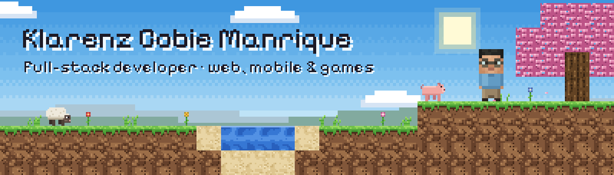
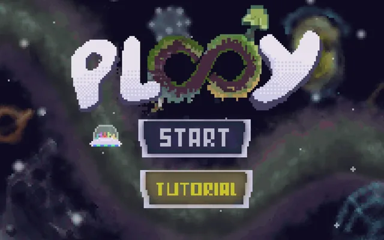

**Open to onsite OJT internships in Metro Manila** · Dec 1, 2026 – Feb 13, 2027 (can start earlier) · 486 hours

I'm a 4th-year BS Information Technology student at Pamantasan ng Lungsod ng Pasig (Class of 2027). I build web apps, APIs, and mobile clients end to end, and ship them with Docker and AWS. Five years helping at a computer café taught me to troubleshoot calmly and explain things plainly.

**[Portfolio](https://klarenzcom.vercel.app/)** · **[LinkedIn](https://www.linkedin.com/in/klarenz-cobie-899656392/)** · **[Resume (PDF)](https://klarenzcom.vercel.app/resume/Klarenz-Cobie-Manrique-Resume.pdf)** · **[Email](mailto:klarenzcobie99@gmail.com)**

## Featured projects

<table>
  <tr>
    <td width="33%" valign="top">
       
      
      
<b>EcoPin</b> Full-stack developer · Capstone

      
Waste reporting and cleanup for Pasig City's Solid Waste Management Office.

      
Next.js · Express · Flutter · Python · AWS

      
<a href="https://ecopin-web.vercel.app/">Live demo</a> · <a href="https://github.com/klacom/ecopin_backend_node">Code</a>

    </td>
    <td width="33%" valign="top">
       
      
      
<b>Plooy</b> Lead programmer · Game jam

      
2nd place and People's Choice at GameCon! Game Jam Manila 2025.

      
Godot · GDScript

      
<a href="https://artsaac.itch.io/plooy">Play</a> · <a href="https://github.com/baldopadua/PLOOY">Code</a>

    </td>
    <td width="33%" valign="top">
       
      
      
<b>Tanggolin</b> Programmer · Hackathon

      
Top 12 of 280+ teams at the AppBuildersPH Hackathon.

      
Kotlin · ONNX · on-device AI

      
<a href="https://github.com/baldopadua/App-Builders-Hackathon">Code</a>

    </td>
  </tr>
</table>

## Tech stack

<table>
  <tr>
    <td><b>Frontend</b></td>
    <td></td>
  </tr>
  <tr>
    <td><b>Backend and data</b></td>
    <td></td>
  </tr>
  <tr>
    <td><b>Mobile</b></td>
    <td></td>
  </tr>
  <tr>
    <td><b>DevOps</b></td>
    <td></td>
  </tr>
  <tr>
    <td><b>Applied AI</b></td>
    <td> &nbsp;ONNX · Google OR-Tools</td>
  </tr>
  <tr>
    <td><b>Games</b></td>
    <td></td>
  </tr>
</table>

---

**Hiring an OJT intern for December to February?** [Email me](mailto:klarenzcobie99@gmail.com) or [connect on LinkedIn](https://www.linkedin.com/in/klarenz-cobie-899656392/). I'd like to hear what your team is building.
