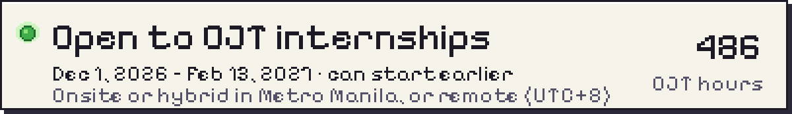
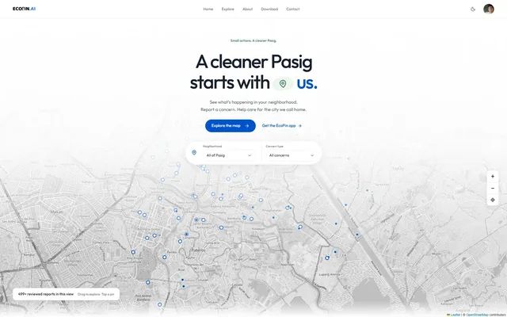

I'm a 4th-year BS Information Technology student at Pamantasan ng Lungsod ng Pasig (Class of 2027). I build web apps, APIs, and mobile clients end to end, and ship them with Docker and AWS. Five years helping at a computer café taught me to troubleshoot calmly and explain things plainly.

**[Portfolio](https://klarenzcom.vercel.app/)** · **[LinkedIn](https://www.linkedin.com/in/klarenz-cobie-899656392/)** · **[Resume (PDF)](https://klarenzcom.vercel.app/resume/Klarenz-Cobie-Manrique-Resume.pdf)** · **[Email](mailto:klarenzcobie99@gmail.com)**

## Featured projects

<table>
  <tr>
    <td width="33%" valign="top">
      
       <b>EcoPin</b> · Full-stack developer
       Waste reporting and cleanup for Pasig City's Solid Waste Management Office.
       Next.js · Express · Flutter · Python · AWS
       <a href="https://ecopin-web.vercel.app/">Live demo</a> · <a href="https://github.com/klacom/ecopin_backend_node">Code</a>
    </td>
    <td width="33%" valign="top">
      
       <b>Plooy</b> · Lead programmer
       2nd place and People's Choice at GameCon! Game Jam Manila 2025.
       Godot · GDScript
       <a href="https://artsaac.itch.io/plooy">Play</a> · <a href="https://github.com/baldopadua/PLOOY">Code</a>
    </td>
    <td width="33%" valign="top">
      
       <b>Tanggolin</b> · Programmer
       Top 12 of 280+ teams at the AppBuildersPH Hackathon.
       Kotlin · ONNX · on-device AI
       <a href="https://github.com/baldopadua/App-Builders-Hackathon">Code</a>
    </td>
  </tr>
</table>

Also built: <a href="https://github.com/klacom/ibp-makati-ulas">an attendance system for IBP Makati</a> · <a href="https://github.com/klacom/pithos">Pithos, an e-commerce platform</a> · <a href="https://github.com/klacom/portfolio-mc">my pixel-world portfolio</a>

## Tech stack

<table>
  <tr>
    <td><b>Frontend</b></td>
    <td></td>
  </tr>
  <tr>
    <td><b>Backend and data</b></td>
    <td></td>
  </tr>
  <tr>
    <td><b>Mobile</b></td>
    <td></td>
  </tr>
  <tr>
    <td><b>DevOps</b></td>
    <td></td>
  </tr>
  <tr>
    <td><b>Applied AI</b></td>
    <td> &nbsp;ONNX · Google OR-Tools</td>
  </tr>
  <tr>
    <td><b>Games</b></td>
    <td></td>
  </tr>
</table>

---

**Hiring an OJT intern for December to February?** [Email me](mailto:klarenzcobie99@gmail.com) or [connect on LinkedIn](https://www.linkedin.com/in/klarenz-cobie-899656392/). I'd like to hear what your team is building.
