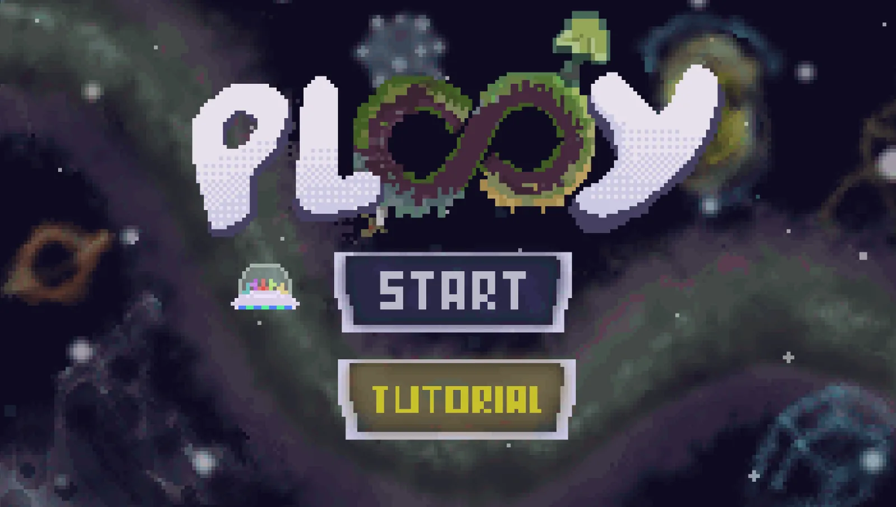

# Hi, I'm Klarenz.

**IT student building for the web, mobile, and games.**

I'm **Klarenz Cobie Manrique**, a fourth-year BS Information Technology student at **Pamantasan ng Lungsod ng Pasig**, graduating in **2027**. I build full-stack apps, mobile tools, and games, and explore applied AI through projects that run on phones and support city services.

Five years helping at a computer café taught me to troubleshoot calmly and explain technical problems clearly. I bring that same approach to the software I build.

**Taytay, Rizal, Philippines** · [Get in touch](mailto:klarenzcobie99@gmail.com)

## Selected builds

### EcoPin

**Full-stack developer · Capstone project**

A waste-reporting and cleanup platform built for Pasig City's Solid Waste Management Office. Residents report concerns on a map, while crews manage dispatch, cleanup evidence, and barangay analytics.

- Built features across the web app, mobile app, and backend, including offline synchronization.
- Wrote Python routing and forecasting services, added privacy controls, and automated AWS deployment pipelines.

[Live demo](https://ecopin-web.vercel.app/) · [Web](https://github.com/baldopadua/ecopin-web) · [Mobile](https://github.com/klacom/ecopin_app) · [Backend](https://github.com/klacom/ecopin_backend_node) · [ML models](https://github.com/klacom/ecopin_ml_models)

See EcoPin

### Plooy

**Lead programmer · GameCon! Game Jam Manila 2025**

A team-built game developed in **Godot and GDScript**. I led the programming and developed the game's features.

Our team won **2nd place** and received **People's Choice** recognition.

[Play on itch.io](https://artsaac.itch.io/plooy) · [Code](https://github.com/baldopadua/PLOOY)

See Plooy

### Tanggolin

**Programmer · AppBuildersPH Hackathon**

An Android keyboard that uses on-device AI to catch sensitive information before it leaves the phone. I contributed **Kotlin keyboard logic** and integrated **quantized ONNX inference** to run the model locally.

Our team was selected as **one of 12 finalists out of 280+ teams**.

[Code](https://github.com/baldopadua/App-Builders-Hackathon)

See Tanggolin

## Tools I work with

| Area | Languages and tools |
| --- | --- |
| Web and backend | TypeScript, JavaScript, Next.js, Node.js, .NET |
| Mobile | Kotlin, Flutter, Dart |
| Games | Godot, GDScript, C#, Lua |
| Data and applied AI | Python, PostgreSQL, MySQL, Supabase, ONNX, Google OR-Tools |
| Deployment | AWS EC2, AWS Lambda, Docker, GitHub Actions |

## Currently exploring

- **Playable web experiences:** an interactive pixel-world portfolio built with Next.js and a custom tile engine.
- **AI on ordinary phones:** quantized models and offline inference with ONNX.
- **Routing and forecasting:** Python services for planning city cleanup work.

If you're building something in web, mobile, or games, I'd like to hear about it.

[klarenzcobie99@gmail.com](mailto:klarenzcobie99@gmail.com)
